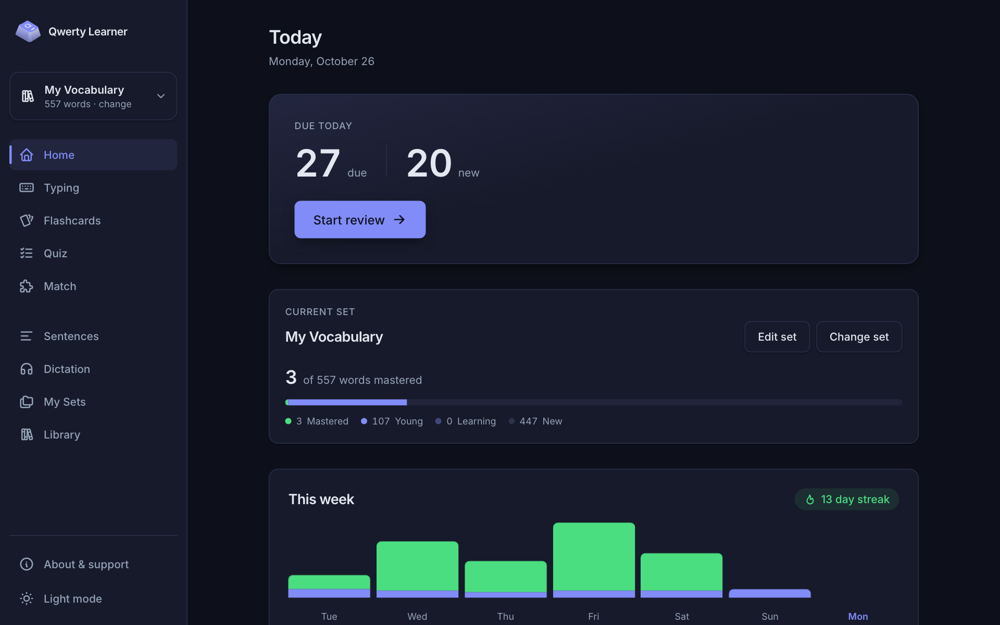
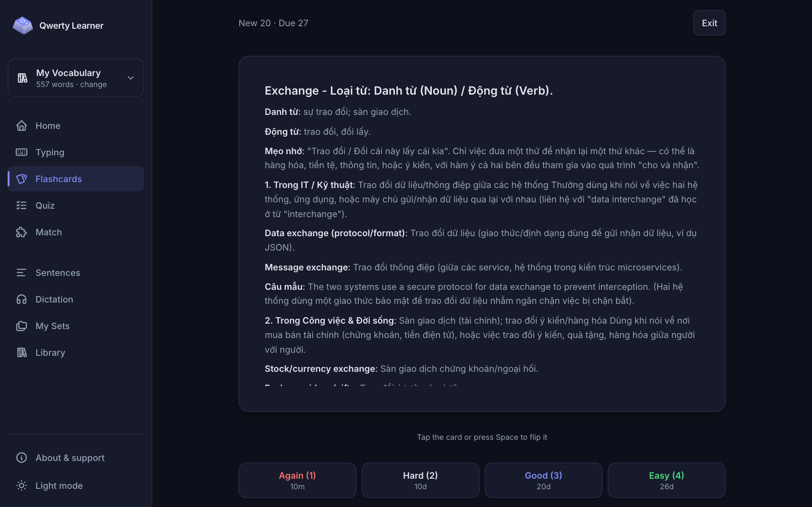
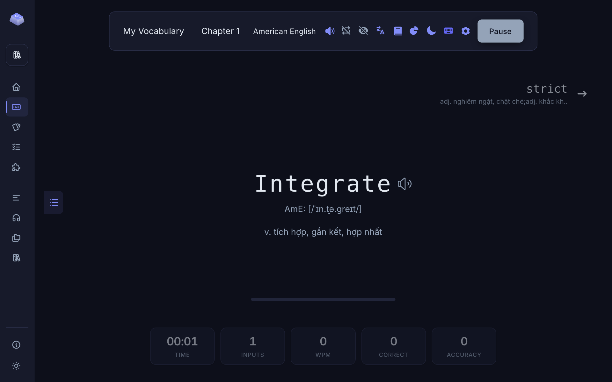
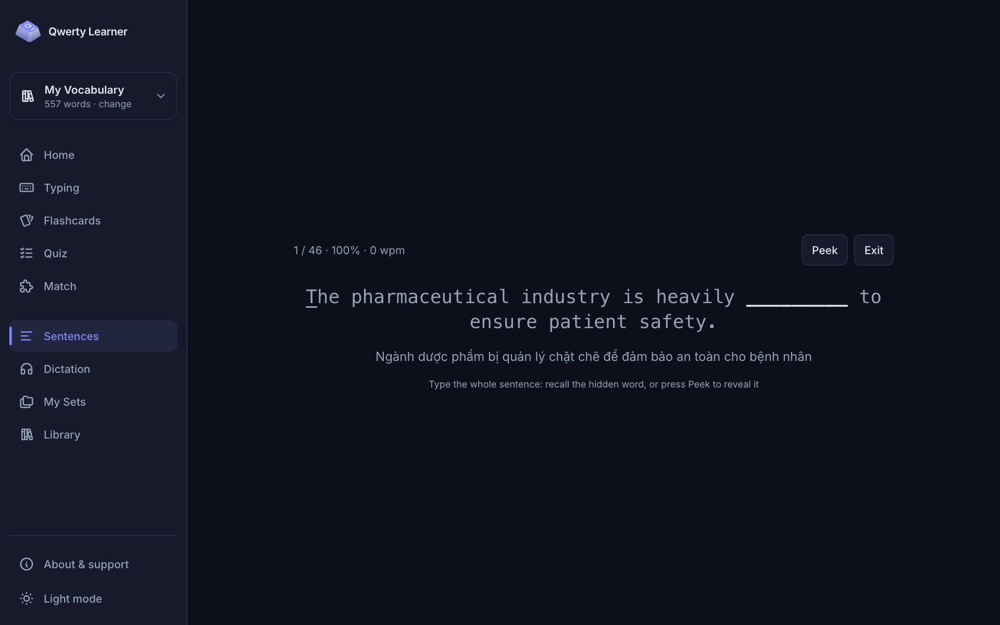
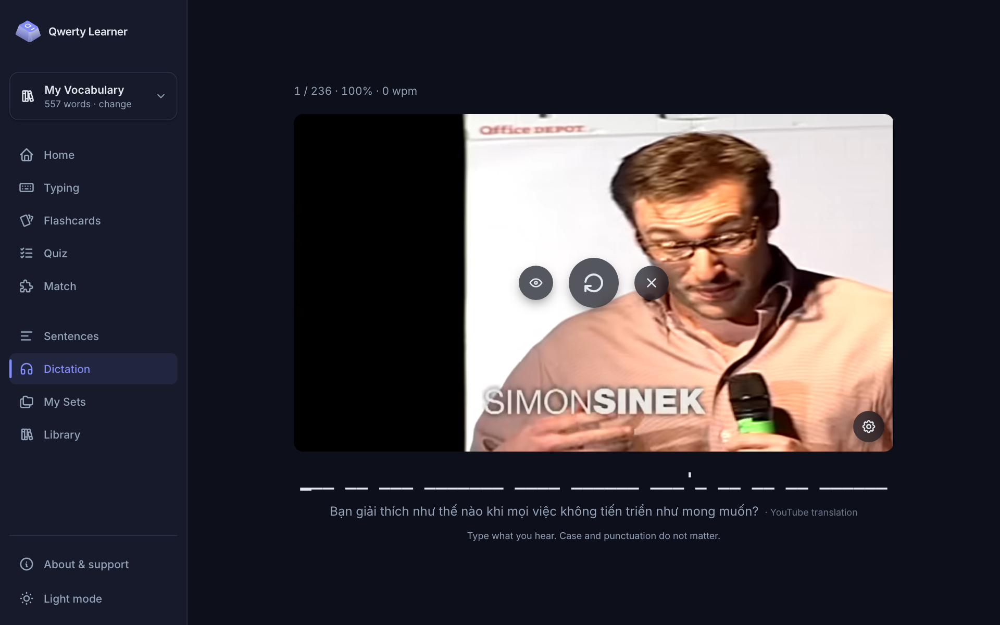
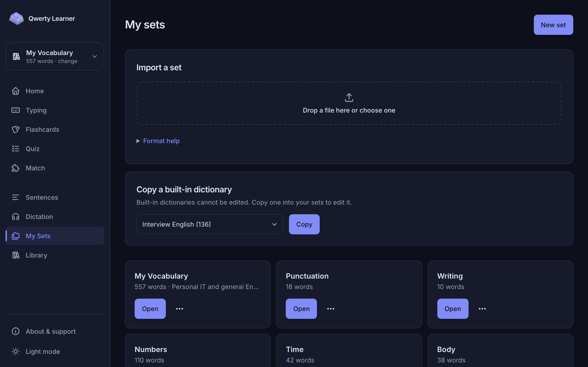

# Qwerty Learner (personal fork)

A personal version of [Qwerty Learner](https://github.com/RealKai42/qwerty-learner) for learning English: type words to train
spelling, review them with spaced-repetition flashcards, test yourself with quizzes and games, type whole example sentences, and
practise listening by typing what is said in YouTube videos. Meanings are in Vietnamese (the most used dictionaries are translated;
the rest are still in Chinese).

It runs on your own computer. A small local server keeps all your progress in **one file on your disk**, with daily backups, so
nothing is lost when the browser's data is cleared.



## What it does

| Mode           | What you do                                                                                                |
| -------------- | ---------------------------------------------------------------------------------------------------------- |
| **Typing**     | Type each word of a chapter; a wrong letter resets the word, so the spelling ends up in your fingers.      |
| **Flashcards** | Anki-style spaced repetition: due cards first, then new ones, graded Again / Hard / Good / Easy.           |
| **Quiz**       | Multiple choice, word → meaning or meaning → word; misses come back sooner in your flashcards.             |
| **Match**      | Match 6 words with their meanings against the clock.                                                       |
| **Sentences**  | Type a full example sentence with the key word hidden, using the Vietnamese meaning as a hint.             |
| **Dictation**  | Listen to a YouTube video one sentence at a time and type what you hear, with the Vietnamese as a hint.    |
| **My Sets**    | Make your own word lists by hand or import CSV/JSON; _My Vocabulary_ and _Interview English_ are included. |











## Run it

You need [Node.js](https://nodejs.org/) 22.13 or later and [Yarn](https://yarnpkg.com/).

```bash
yarn install
yarn dev:full
```

Then open <http://localhost:5173>. `dev:full` starts the app and its data server together; development data goes into
`./.dev-data` (never committed).

| Command              | What it does                                                   |
| -------------------- | -------------------------------------------------------------- |
| `yarn dev:full`      | Starts the app and the data server locally with live reload    |
| `yarn test`          | Runs the unit tests                                            |
| `yarn lint`          | Checks the code with ESLint                                    |
| `yarn stable:update` | Builds the stable copy from `feat/study-modes` and restarts it |

### A stable copy for everyday use

For studying every day, run a **stable copy** next to the development one: it lives at <http://localhost:4173>, keeps your real
data in a folder you choose (for example `~/Library/Application Support/qwerty-learner`), starts at login and only changes when you
update it. The full guide, including moving existing data out of the browser, backups and restoring, is in
[docs/stable-deploy.md](docs/stable-deploy.md).

### Dictation needs two tools

Dictation fetches a video's subtitles with [yt-dlp](https://github.com/yt-dlp/yt-dlp) (no video is downloaded) and translates
sentences YouTube has no Vietnamese for with the [Claude Code](https://claude.com/claude-code) CLI. Install yt-dlp with
`brew install yt-dlp`; each prepared video is cached, so it opens at once afterwards. See
[docs/stable-deploy.md](docs/stable-deploy.md#7-dictation-listening-to-youtube-videos) for the stable copy's settings.

## How to use it

### Pick a set

Every study mode works on the **current set**, shown at the top of the sidebar (on a phone, at the top of the screen). Click it to
change it. **Library** has the built-in dictionaries (CET-4, CET-6, IELTS, TOEFL, Oxford 3000, school textbooks and more);
**My Sets** has the sets you made yourself.

### Flashcards

1. Press **Start**. You get the cards due today, then new cards (20 a day by default; change it under _New cards per day_).
2. Look at the front, try to remember, then flip the card (click it or press <kbd>Space</kbd>).
3. Grade yourself. The label under each button shows when you will see the card again.

| Button    | Key          | Use it when                                      |
| --------- | ------------ | ------------------------------------------------ |
| **Again** | <kbd>1</kbd> | You forgot. The card comes back in this session. |
| **Hard**  | <kbd>2</kbd> | You remembered with difficulty.                  |
| **Good**  | <kbd>3</kbd> | You remembered.                                  |
| **Easy**  | <kbd>4</kbd> | You knew it instantly.                           |

When everything is done, **+10 new / +20 new** adds more new cards for today only, and **Practice** goes through cards again
without changing your schedule. Tick _Show the meaning first_ to practise the other way round.

### Sentences

Choose **Today** (the words due or new today, as in Flashcards) or **All words**. Each sentence is shown with its key word hidden;
type the whole sentence. **Peek** reveals the word and counts one mistake. Nothing you do here changes your flashcard schedule.

### Dictation

Paste a YouTube link or pick a suggested talk. The first time, the video is prepared (subtitles, sentences, Vietnamese); then:

- Each sentence plays and the video pauses; type it from the blanks. Case and punctuation do not matter.
- The controls sit on the video: **replay** the sentence, **show / hide** it (showing it counts one mistake), **exit**.
- The **settings** button turns YouTube's subtitles on or off (off by default: they give the sentence away) and changes the speed
  (0.5× to 1.25×).
- Progress is saved after every sentence; next time you continue where you stopped.

### My Sets

- **New set**: type the words in by hand (word, meanings one per line, optional US/UK phonetics and a detail shown on the back of a
  flashcard).
- **Import a set**: drop CSV or JSON files; each file becomes one set.
- **Copy a built-in dictionary** to edit it.

**CSV format.** One word per row; a header row is optional.

```csv
name,trans,usphone,ukphone,detail
abandon,v. bỏ rơi; từ bỏ,əˈbændən,əˈbændən,
benefit,n. lợi ích; v. có lợi cho,ˈbenɪfɪt,ˈbenɪfɪt,"A longer note
over two lines"
```

`name` (or `word`) and `trans` (or `meaning`) are required; separate meanings with `;`. **JSON** uses the same format as the
built-in dictionaries: `[{ "name": "abandon", "trans": ["v. bỏ rơi"], "usphone": "əˈbændən", "ukphone": "əˈbændən" }]`.

### Your data

Everything you do is written to `qwerty.db` in the data folder, with a backup every day (the last 14 days and 8 Sundays are kept).
Settings → Data in the **Typing** screen also exports everything to a file you can keep anywhere, and imports it back.

## Credits and license

Based on [Qwerty Learner](https://github.com/RealKai42/qwerty-learner) by RealKai42 and its contributors, including the built-in
dictionaries. Licensed under the [GNU GPL v3](./LICENSE), like the original.
